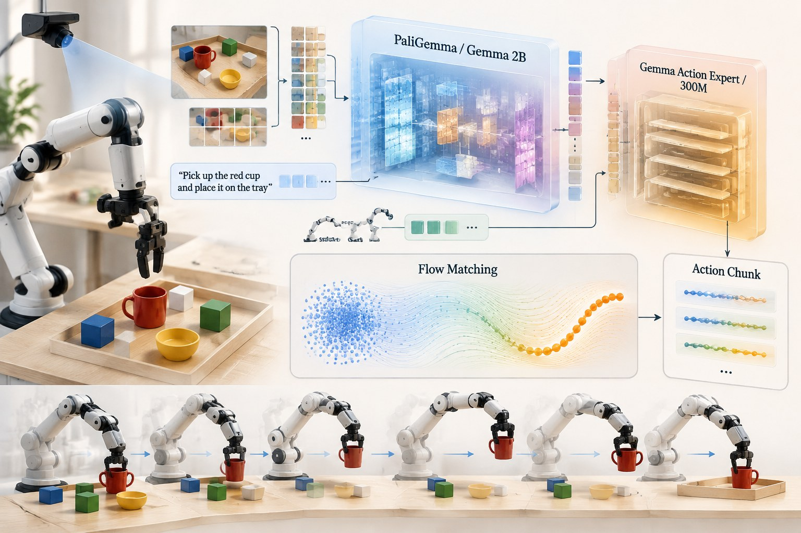
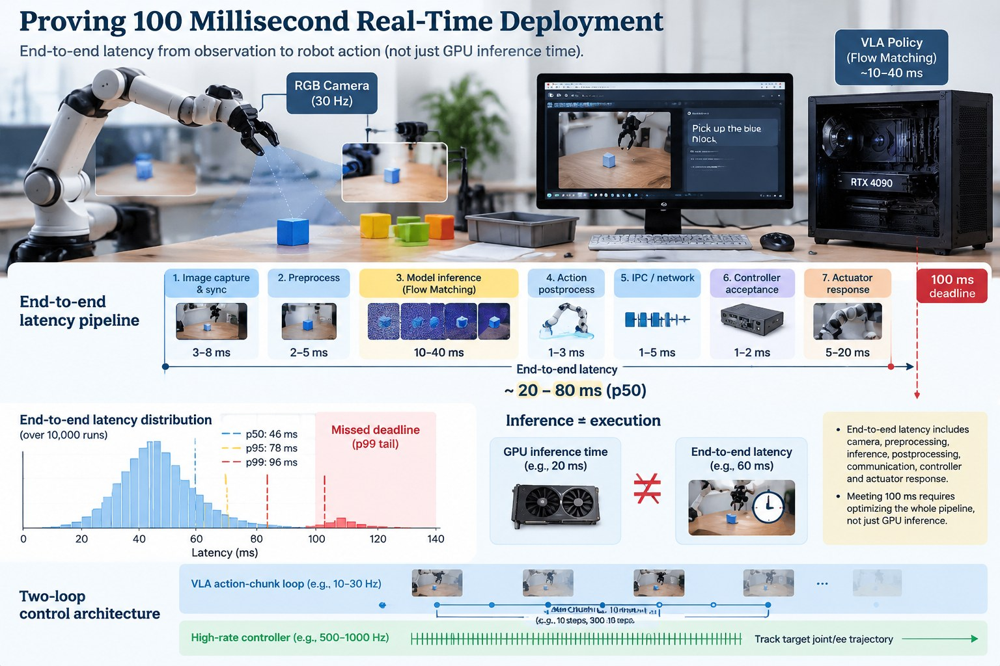
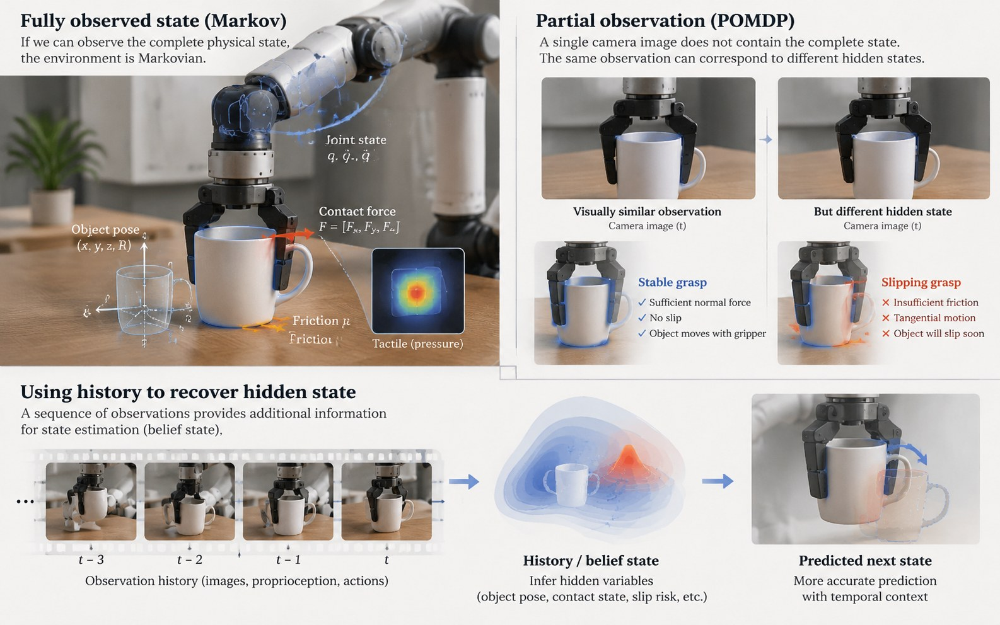
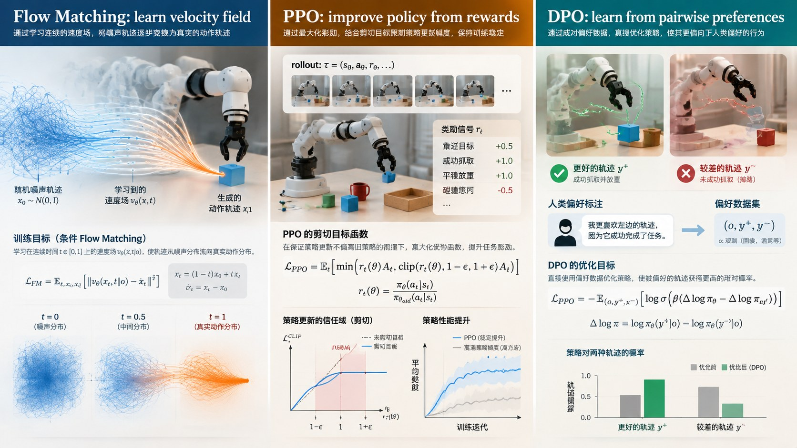
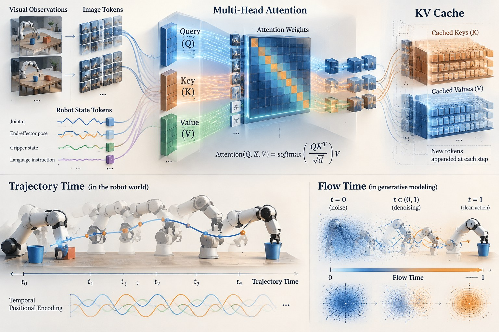
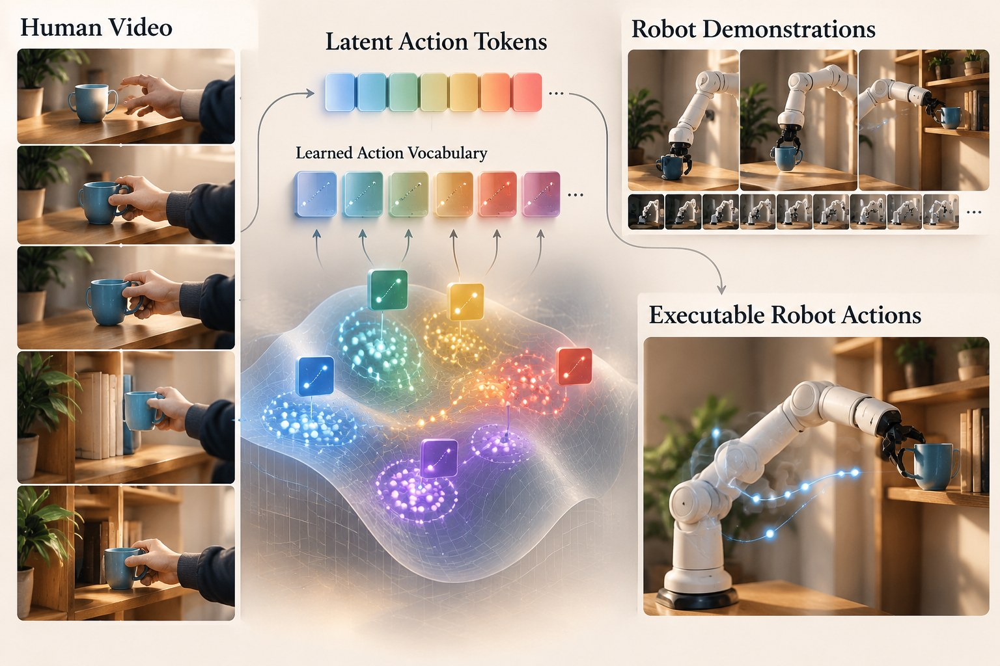
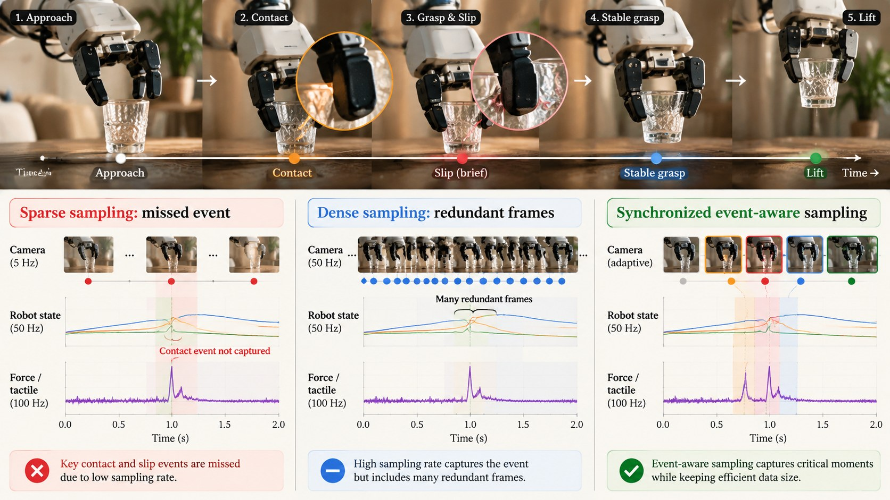
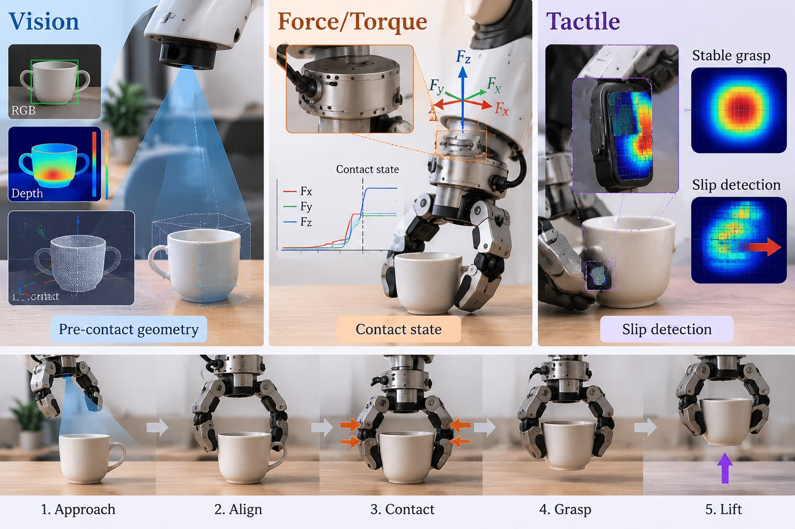

# VLA 与机器人学习：知识问题整合手册

> **版本：** 2026-10-17
> 
> **配图：** 技术插图使用 ImageGen 生成，作为概念辅助图；公式、模型细节和代码事实以论文及官方仓库为准。图片中的文字或公式可能存在生成误差，不应作为事实来源。

## 目录

1. [π₀、π₀.₅ 与 Gemma Action Expert](#1-π₀π₀₅-与-gemma-action-expert)
2. [如何证明机器人部署达到 100 ms](#2-如何证明机器人部署达到-100-ms)
3. [机器人中的马尔可夫性质与 POMDP](#3-机器人中的马尔可夫性质与-pomdp)
4. [Flow Matching：从噪声到连续动作的训练推导](#4-flow-matching从噪声到连续动作的训练推导)
5. [Flow Matching、PPO 与 DPO 的目标区别](#5-flow-matchingppo-与-dpo-的目标区别)
6. [连续动作、离散动作 Token 与 Latent Action](#6-连续动作离散动作-token-与-latent-action)
7. [机械臂轨迹的位置编码](#7-机械臂轨迹的位置编码)
8. [QKV、Attention 与 KV Cache 的张量形状](#8-qkvattention-与-kv-cache-的张量形状)
9. [ACT 与 RTC：动作分块和实时执行](#9-act-与-rtc动作分块和实时执行)
10. [LAPA、GO-1、RT-2 与 OpenVLA](#10-lapago-1rt-2-与-openvla)
11. [LoRA：用在哪里、如何理解训练效果](#11-lora用在哪里如何理解训练效果)
12. [关节空间与末端位姿：动作表示及数据对齐](#12-关节空间与末端位姿动作表示及数据对齐)
13. [UMI 数据与数据增强的常见问题](#13-umi-数据与数据增强的常见问题)
14. [抽帧、采样频率与“为什么不直接采快一点”](#14-抽帧采样频率与为什么不直接采快一点)
15. [视觉、力觉与触觉分别提供什么信息](#15-视觉力觉与触觉分别提供什么信息)
16. [常见概念辨析与复习清单](#16-常见概念辨析与复习清单)

---

## 1. π₀、π₀.₅ 与 Gemma Action Expert



### 1.1 先用一句话理解

**π₀ / π₀.₅ 是视觉—语言—动作模型：视觉语言主干理解“看到了什么、要做什么”，动作专家根据条件生成一段连续机器人动作。**

它不是简单地让 Gemma 像写句子一样逐个输出“向左 0.1、向前 0.2”。在 OpenPI 的公开实现中，连续动作片段由 Flow Matching 路径生成。

### 1.2 Gemma Action Expert 到底是什么？

OpenPI 的公开配置包含以下关键项：

- `paligemma_variant="gemma_2b"`：视觉语言主干配置；
- `action_expert_variant="gemma_300m"`：专门处理动作序列的较小 Gemma-family expert；
- `action_dim`：每个动作时间步的维度；
- `action_horizon`：一个动作 chunk 包含多少个时间步；
- `pi05`：选择 π₀ 或 π₀.₅ 的若干结构差异。

PaliGemma 不只是纯文本 Gemma：它包含视觉编码路径与语言模型部分。图像经视觉编码器变成视觉 token，指令经 tokenizer 变成语言 token，机器人状态也按具体模型配置转换成相应输入。

**Action Expert 不是一个额外的自然语言生成头。** 它是为连续动作序列建模的 Transformer/Gemma-family 专家。它接收带噪动作序列和条件信息，预测 Flow Matching 所需的向量场（velocity field），再通过数值积分得到动作 chunk。

可以将推理过程概括为：

1. 输入图像、语言指令与机器人状态；
2. 视觉语言主干处理条件信息，形成可供动作生成使用的表示；
3. 采样一个与目标动作 chunk 同形状的噪声张量；
4. 将噪声动作、生成时间和条件送入动作专家，预测当前动作样本应如何变化；
5. 经过若干数值积分步骤，得到连续动作片段；
6. 对动作反归一化、映射到机器人控制接口，再由低层控制器执行。

若动作张量是 $`A\in\mathbb{R}^{B\times H\times D_a}`$，则 $`B`$ 为 batch size，$`H`$ 为 chunk 长度，$`D_a`$ 为每步动作维度。这里的 $`H`$ 是机器人轨迹的时间长度，**不是 Flow Matching 的积分步数**。

### 1.3 π₀ 与 π₀.₅ 有哪些差异？

| 维度 | π₀ | π₀.₅ |
|---|---|---|
| 目标侧重点 | 通用机器人连续动作生成 | 更强调异构任务共训与开放世界泛化 |
| 状态输入 | 官方 OpenPI 配置中，状态通过连续输入路径进入动作 suffix | 默认将状态离散化并作为语言 token 输入 |
| 时间条件 | 通过动作/时间相关投影路径注入 | 动作专家使用 adaRMSNorm 注入 Flow Matching 时间条件 |
| 训练数据思路 | 大规模机器人示教与连续动作建模 | 更强调跨机器人、语义子任务预测、网页/图文等异构监督组合 |
| 默认 token 长度 | OpenPI 当前配置默认为 48 | OpenPI 当前配置默认为 200 |

表中的代码细节依据 OpenPI 当前公开配置；仓库会更新，复现时应核对使用的 commit 和训练配置。参考：[OpenPI `pi0_config.py`](https://github.com/Physical-Intelligence/openpi/blob/main/src/openpi/models/pi0_config.py)、[π₀ 论文](https://arxiv.org/abs/2410.24164)、[π₀.₅ 论文](https://arxiv.org/abs/2504.16054)。

### 1.4 为什么需要 Action Expert，而不让 VLM 直接生成动作文字？

连续控制和语言生成的输出结构不同：

- 语言通常是离散 token 序列；
- 机器人动作是连续数值序列，且相邻时间步之间有很强的动态关联；
- 连续动作需要考虑尺度、轨迹形状、时间一致性和低层控制接口；
- Flow Matching 可以学习一个动作分布，而不是把动作逐维量化成文字 token。

动作专家相当于给机器人动作建模提供专门的参数路径与生成目标。它并不意味着视觉语言主干“完全不参与动作”：动作专家仍然依赖图像、语言和状态条件。

### 1.5 看代码时应该检查什么？

推荐阅读顺序：

1. `src/openpi/models/pi0_config.py`：模型变体、动作维度、chunk 长度、`pi05` 标志；
2. `src/openpi/models/pi0.py`：prefix/suffix 构造、Flow Matching loss、动作采样；
3. `src/openpi/models/gemma.py`：Gemma-family Transformer、注意力和 adaRMSNorm；
4. `src/openpi/transforms.py` 与数据配置：图像、状态、动作和文本如何预处理；
5. policy 推理入口：动作反归一化、输出队列与控制接口。

**常见误区：** 只把 `pi05=True` 打开，并不等于完整复现 π₀.₅ 的训练配方；数据混合、语义监督、状态 tokenization、动作维度与归一化都必须匹配。

---

## 2. 如何证明机器人部署达到 100 ms



### 2.1 先定义“100 ms”到底指什么

“模型推理耗时 100 ms”“每 100 ms 输出一次动作”和“从新观测到机器人开始执行动作不超过 100 ms”是三个不同的主张。

- **模型推理延迟：** 输入张量已经准备好，到模型输出动作张量的时间；
- **端到端决策延迟：** 从观测可用，到对应动作被控制器接收的时间；
- **执行响应延迟：** 从观测采集开始，到机器人实际运动响应出现的时间；
- **控制频率：** 控制器每秒更新多少次；
- **策略更新频率：** VLA 每秒产生多少次新动作 chunk；
- **动作 chunk 时长：** 一次预测覆盖未来多少秒的控制。

如果声称“100 ms 部署”，必须先明确它指的是哪一项。若声称整个系统实时响应，最有说服力的是测量端到端延迟，而不是只测 GPU 前向传播。

### 2.2 端到端延迟如何定义？

可将一次控制周期的时间分解为：

```math
T_{\mathrm{e2e}} =
T_{\mathrm{capture}}+
T_{\mathrm{pre}}+
T_{\mathrm{infer}}+
T_{\mathrm{post}}+
T_{\mathrm{transport}}+
T_{\mathrm{controller}}+
T_{\mathrm{response}}
```
其中各项分别对应相机采集与同步、预处理、模型推理、动作后处理、通信、控制器接收以及实际执行响应。是否把最后的物理响应纳入指标，取决于论文声称的边界，但必须在报告中明确。

时间戳最好使用单调时钟；若观测、推理和控制分布在不同设备上，要处理时钟同步误差。应记录原始时间戳，不要只依靠程序日志中相邻两行的时间差。

### 2.3 一套可复现的测量流程

1. **明确计时边界。** 例如从相机帧完成采集，到控制器确认收到对应动作。
2. **先预热。** 模型编译、CUDA 初始化、显存分配、缓存建立等会让前几次运行异常慢；应将预热阶段单独记录。
3. **固定条件。** 记录硬件、软件版本、图像分辨率、batch size、Flow Matching 采样步数、是否并发、网络与控制器配置。
4. **重复足够多次。** 报告样本数和完整延迟分布；几次最快的结果不能代表系统性能。
5. **报告分位数。** 至少报告 p50、p95、p99、最大观测值和 deadline miss rate（超时比例）。
6. **同时报告成功率和控制质量。** 不能为了更低延迟而悄悄缩短动作 chunk、减少观测质量或牺牲任务成功率，却仍声称性能完全相同。
7. **做负载测试。** 在真实部署时会出现的 GPU、CPU、网络和日志负载下重复测试。

### 2.4 p95 小于 100 ms，就证明实时了吗？

这只能证明：在指定测试条件和样本范围内，95% 的观测延迟小于 100 ms。它**不能单独证明硬实时系统的最坏情况执行时间有上界**。

- 对软实时任务，p95/p99、超时率与任务成功率是很有用的工程指标；
- 对硬实时任务，需要更严格的最坏情况执行时间（WCET）、调度、通信和故障处理论证；
- 对真机论文，应该报告测试环境、样本数、延迟分布与超时处理方式，避免把经验测量写成绝对保证。

### 2.5 为什么 chunk 策略与实时性有关？

如果 VLA 一次输出未来 $`H`$ 步动作，并在推理期间由机器人继续执行旧 chunk，策略推理频率就可以低于底层控制频率。但这不等于“VLA 本身达到高频控制”。

例如，机器人控制器以 500 Hz 跟踪已下发轨迹，而 VLA 平均每 100 ms 更新一次动作 chunk。此时 500 Hz 是低层控制更新频率，10 Hz 是策略更新频率；两者职责不同。RTC 一类方法进一步处理下一段动作生成时的异步衔接，见第 9 节。

---

## 3. 机器人中的马尔可夫性质与 POMDP



### 3.1 马尔可夫性质的定义

若系统状态 $`s_t`$ 包含预测未来所需的全部信息，则满足马尔可夫性质：

```math
p(s_{t+1}\mid s_t,a_t,s_{t-1},a_{t-1},\ldots)
=
p(s_{t+1}\mid s_t,a_t)
```
直观上，给定当前完整状态和当前动作后，更早的历史不再提供额外的下一状态预测信息。

### 3.2 机器人什么时候看起来不满足马尔可夫性质？

严格地说，很多物理系统在**完整状态**下仍然可以是 Markov 的；实际机器人算法常用的观测或简化状态却不完整，所以表现为非马尔可夫。

常见原因包括：

1. **部分可观测：** 单张 RGB 图像看不到物体背面、真实深度、接触力、摩擦系数或被遮挡物体；
2. **缺少速度信息：** 仅知道当前位置，不知道速度时，同一位置可能对应不同的未来运动；
3. **隐藏接触状态：** 两个视觉相似的抓取，一个夹稳了，另一个正处于滑移边缘；
4. **执行器与通信延迟：** 当前观测对应的动作可能还在队列中，若状态不包含待执行命令，未来就依赖“看不见的历史”；
5. **未建模的环境变化：** 摩擦、柔顺性、物体质量、人的运动等可能改变动力学；
6. **任务具有历史依赖：** 例如按钮是否已按下、抽屉是否解锁、前一阶段是否完成，若这些信息没有进入状态，当前观测就不足以决定下一步。

### 3.3 MDP、POMDP 与历史信息

- **MDP：** 状态充分，给定当前状态和动作即可描述下一状态分布；
- **POMDP：** 智能体只观察到状态的部分信息 $`o_t`$，真实状态 $`s_t`$ 不可直接获得；
- **Observation history：** 过去的观测和动作序列，可以帮助推断隐藏状态；
- **Belief state：** 对隐藏状态的概率分布 $`b_t(s)=p(s_t=s\mid o_{0:t},a_{0:t-1})`$。

在已知模型的 POMDP 中，belief state 可以作为一个充分状态来进行决策。但真实机器人里状态空间巨大、模型未知，通常需要用历史帧、循环网络、Transformer、状态估计器或记忆模块近似地整合历史信息。

### 3.4 实际例子：夹爪与杯子

当前相机图像可能显示夹爪正夹着杯子，但这张图像无法充分判断：

- 夹爪是否施加了足够法向力；
- 杯子是否正发生微滑移；
- 杯子是否已经被提起，还是仅被夹爪挡住；
- 当前动作队列中是否还有一个会继续闭合夹爪的命令。

增加连续图像、关节状态、夹爪电流、力/触觉与动作队列状态，有助于构造更接近 Markov 的决策状态。

### 3.5 面试式回答

> 机器人并不是天然违反马尔可夫性质，而是我们使用的观测往往不是完整状态。比如单帧图像看不到物体速度、接触力或滑移状态，同一张图像可能对应不同的未来。此时问题更准确地说是部分可观测，应该通过状态估计、历史观测、记忆模型或 belief state 来补充信息。如果把这些隐藏变量和动作队列都纳入状态，系统仍然可能满足马尔可夫建模假设。

---

## 4. Flow Matching：从噪声到连续动作的训练推导

### 4.1 目标是什么？

给定观测 $`o`$、语言指令 $`l`$ 和机器人状态 $`s`$，模型需要生成一个未来动作片段 $`A`$。我们希望从简单的噪声分布出发，学习一个随时间变化的向量场，把噪声样本连续地变成符合条件的动作样本。

Flow Matching 训练的是**向量场**，不是简单地直接回归最终动作。

### 4.2 Step 1：定义噪声端与数据端

令真实动作片段为 $`A_{\mathrm{data}}`$，噪声为：

```math
\epsilon\sim\mathcal{N}(0,I)
```
为了推导清楚，先约定 $`t=0`$ 对应噪声、$`t=1`$ 对应真实动作。构造线性插值：

```math
A_t=(1-t)\epsilon+tA_{\mathrm{data}},\quad t\sim\mathcal{U}(0,1)
```
当 $`t=0`$ 时，$`A_t=\epsilon`$；当 $`t=1`$ 时，$`A_t=A_{\mathrm{data}}`$。

### 4.3 Step 2：推导目标速度

对插值式关于 $`t`$ 求导：

```math
\frac{dA_t}{dt}=A_{\mathrm{data}}-\epsilon
```
所以这条条件路径上的目标速度是：

```math
u_t=A_{\mathrm{data}}-\epsilon
```
这一步很关键：模型并不是预测“当前动作值是多少”，而是预测“沿着生成路径，当前样本应该朝哪个方向、以多大速度变化”。

### 4.4 Step 3：训练向量场网络

令模型为 $`v_\theta(A_t,t,c)`$，其中 $`c`$ 表示图像、语言和机器人状态等条件。训练目标为：

```math
\mathcal{L}_{\mathrm{FM}}(\theta)=
\mathbb{E}_{A_{\mathrm{data}},\epsilon,t,c}
\left[
\left\|v_\theta(A_t,t,c)-(A_{\mathrm{data}}-\epsilon)\right\|_2^2
\right]
```
每个训练样本只需采样噪声、采样时间 $`t`$、构造插值样本 $`A_t`$，再计算预测速度与目标速度的差。**训练 loss 不要求先完整积分生成轨迹。** 这就是 Flow Matching 训练形式的一个重要优势。

### 4.5 Step 4：推理时积分生成动作

训练结束后，给定新的条件 $`c`$，从噪声开始：

```math
A(0)\sim\mathcal{N}(0,I)
```
然后求解常微分方程：

```math
\frac{dA(t)}{dt}=v_\theta(A(t),t,c),\quad t\in[0,1]
```
从 $`t=0`$ 积分到 $`t=1`$，得到动作片段 $`A(1)`$。实际推理通常用有限步的 Euler 或其他 ODE 数值积分器近似求解。

### 4.6 为什么论文和代码中的符号有时相反？

不同实现可以采用相反的时间约定。例如 OpenPI 的实现路径常用“$`t=0`$ 为动作、$`t=1`$ 为噪声”的写法：

```math
A_t=(1-t)A_{\mathrm{data}}+t\epsilon,\qquad
u_t=\epsilon-A_{\mathrm{data}}
```
采样时再从 $`t=1`$ 向 $`t=0`$ 积分。它与上面的推导只是时间方向不同，思想相同。**读 Flow Matching 公式时必须先看清楚：哪个端点是噪声、哪个端点是真实数据、积分方向是什么。**

### 4.7 在 VLA 中还要注意什么？

- $`A_t`$ 通常是整段带噪动作 chunk，而不只是单个动作值；
- 轨迹时间步 $`k`$ 与 Flow Matching 时间 $`t`$ 是两个不同概念；
- 视觉、语言和机器人状态提供条件，但生成结果仍要经过反归一化和控制接口映射；
- 采样步数越多通常计算成本越高，但生成质量和稳定性也可能变化；
- Flow Matching 学到的是训练分布中的动作生成规律，并不自动保证碰撞安全、关节限位或接触力安全。

参考：[Flow Matching for Generative Modeling](https://arxiv.org/abs/2210.02747)、[π₀ 论文](https://arxiv.org/abs/2410.24164)。

---

## 5. Flow Matching、PPO 与 DPO 的目标区别



### 5.1 先记住：它们不是同一层面的替代算法

| 方法 | 主要学习目标 | 典型监督/反馈 | 主要用途 |
|---|---|---|---|
| Flow Matching | 学习从简单分布到数据分布的条件向量场 | 目标动作轨迹 | 生成连续动作或动作 chunk |
| PPO | 根据环境回报优化策略 | rollout、reward、advantage | 强化学习与在线策略优化 |
| DPO | 让偏好更高的回答/轨迹相对更可能 | 成对偏好数据 | 直接用偏好数据调整策略，无需单独拟合传统 reward model |

Flow Matching 更像是**动作生成的建模目标**；PPO 是**强化学习策略优化算法**；DPO 是**偏好对齐目标**。三者可以处在一个系统的不同环节，而不一定只能选一个。

### 5.2 PPO：根据奖励改进策略

PPO 常见的 clipped surrogate objective 为：

```math
L^{\mathrm{CLIP}}(\theta)=
\mathbb{E}_t\left[
\min\left(
r_t(\theta)\hat A_t,\,
\mathrm{clip}(r_t(\theta),1-\epsilon,1+\epsilon)\hat A_t
\right)
\right]
```
其中：

```math
r_t(\theta)=
\frac{\pi_\theta(a_t\mid s_t)}
{\pi_{\theta_{\mathrm{old}}}(a_t\mid s_t)}
```
- $`\pi_\theta`$ 是当前策略，$`\pi_{\theta_{\mathrm{old}}}`$ 是采集 rollout 时的旧策略；
- $`\hat A_t`$ 是优势估计，反映动作相对基线的好坏；
- $`\epsilon`$ 控制概率比值允许变化的范围，减少单次更新过大带来的不稳定。

PPO 通常通过“采集环境交互数据 → 计算回报和优势 → 多轮小批量更新策略”迭代。它可以用于连续动作或离散动作，但机器人真机强化学习成本较高，奖励设计、重置、探索和安全都很重要。

### 5.3 Advantage、Value 与 Reward 不要混淆

- **Reward $`r_t`$：** 某一步或某个事件得到的即时奖励；
- **Value $`V(s)`$：** 从状态 $`s`$ 出发，按某策略未来能获得的期望回报；
- **Action-value $`Q(s,a)`$：** 在状态 $`s`$ 执行动作 $`a`$ 后，未来期望回报；
- **Advantage $`A(s,a)`$：** 动作相对于状态基线的额外价值，常写为 $`A(s,a)=Q(s,a)-V(s)`$。

所以 Advantage Head 不等于普通成功分类器。二分类器回答“成功/失败概率是多少”；优势估计则试图回答“在这个状态下，这个动作相对基线究竟好多少”。若缺乏可靠的回报、状态—动作覆盖或价值基线，优势头很容易过拟合。

### 5.4 DPO：直接从偏好数据学习

DPO 常用的数据形式是 $`(x,y^+,y^-)`$：给定同一个条件 $`x`$，人类或评价规则偏好 $`y^+`$ 而不是 $`y^-`$。其常见损失可以写成：

```math
\mathcal{L}_{\mathrm{DPO}}(\theta)=
-\mathbb{E}
\left[
\log\sigma\left(
\beta\left[
\log\frac{\pi_\theta(y^+\mid x)}{\pi_{\mathrm{ref}}(y^+\mid x)}
-
\log\frac{\pi_\theta(y^-\mid x)}{\pi_{\mathrm{ref}}(y^-\mid x)}
\right]
\right)
\right]
```
- $`\pi_\theta`$ 是正在优化的策略；
- $`\pi_{\mathrm{ref}}`$ 是参考策略；
- $`y^+`$ 和 $`y^-`$ 是优选与较差的候选；
- $`\beta`$ 控制偏好优化强度。

DPO 通过比较策略对优选和较差样本的相对概率，隐式实现带参考策略约束的偏好优化；它不要求先训练一个单独的传统 reward model，再用 PPO 优化该模型的奖励。

在机器人中，$`y^+`$ 和 $`y^-`$ 可以是两段动作轨迹，但前提是偏好标签可信、候选条件可比，而且动作序列的概率可以合理计算。轨迹偏好也可能包含安全性、平滑性和任务进度等多个标准，需要定义清楚。

### 5.5 三者能否组合？

可以，但要明确每个模块在做什么：

- **SFT + Flow Matching：** 用示教轨迹训练连续动作生成策略；
- **Flow Matching + DPO：** 先有一个可生成动作的策略，再利用轨迹偏好调整生成分布；具体目标和概率计算需要与连续动作生成机制匹配；
- **Flow Matching + PPO：** 用 Flow Matching 参数化策略，再利用环境回报进行策略优化；需要正确处理策略概率、采样和梯度估计，不能把普通 FM 的速度回归 loss 直接称为 PPO loss；
- **评价器/Reward Model：** 可用于候选轨迹排序或提供强化学习奖励，但其输出质量与分布外泛化必须独立验证。

**一句话总结：** Flow Matching 解决“如何生成动作分布”，PPO 解决“如何根据环境回报改进策略”，DPO 解决“如何让策略更偏好被选中的行为”。

---

## 6. 连续动作、离散动作 Token 与 Latent Action

### 6.1 三种表示的本质区别

- **连续动作：** 直接输出实数向量或实数轨迹，例如末端增量、关节增量、夹爪开度；
- **离散动作 Token：** 把连续动作量化成 token，或把动作序列压缩成离散代码，再像语言 token 一样预测；
- **Latent Action：** 从视频或观测变化中学习的潜在动作代码，不一定与某个机器人控制命令一一对应。

### 6.2 优缺点比较

| 维度 | 连续动作 | 离散动作 Token | Latent Action |
|---|---|---|---|
| 输出空间 | $`\mathbb{R}^{H\times D_a}`$ | 离散 token 序列 | 离散或连续潜在表示 |
| 常见训练目标 | 回归、Diffusion、Flow Matching | 自回归 next-token / 分类损失 | 潜在动作 tokenizer 训练、预测 latent code |
| 优势 | 物理含义直接；精度不受固定 bin 限制 | 可复用 LLM 的序列建模方式；容易与文本 token 统一 | 可以利用没有精确机器人动作标签的视频 |
| 局限 | 普通 MSE 可能把多种动作平均化；生成式方法推理可能较慢 | 量化误差、序列长度与 tokenization 设计影响表现 | latent code 不一定可执行，也不保证唯一对应真实动作 |
| 典型例子 | π₀/π₀.₅ 的连续动作生成 | RT-2、OpenVLA 的离散动作 token 路线 | LAPA 的潜在动作预训练 |

### 6.3 为什么连续动作的普通回归可能“取平均”？

假设同一个观测下有两种可行抓取方式：从左侧绕过障碍，或从右侧绕过障碍。若用单一均方误差回归去拟合两种轨迹，预测值可能落在两条轨迹中间，而中间路径反而会撞到障碍物。

Diffusion/Flow Matching 等生成式方法试图学习多模态动作分布，从而能采样不同的可行轨迹。离散 token 也能表达多模态，但它同样可能因数据偏置或 token 设计而失效。

### 6.4 离散化会损失多少精度？

若某个动作维度的取值区间为 $`[a_{\min},a_{\max}]`$，均匀量化成 $`N`$ 个 bin，则 bin 宽度约为：

```math
\Delta=\frac{a_{\max}-a_{\min}}{N}
```
若使用 bin 中心作为重建值，理想均匀量化下单维最大量化误差约为 $`\Delta/2`$。实际误差还会受分布、裁剪范围、维度归一化和模型预测错误影响。

OpenVLA 的经典动作 token 设置使用每维 256-bin 量化，但不能据此推断所有离散 VLA 都使用同样的方案。

### 6.5 什么时候考虑哪种表示？

- 需要精细连续轨迹，且已经有连续动作训练管线：考虑连续动作头或 Flow Matching；
- 希望最大程度复用自回归语言模型：可以考虑离散动作 token；
- 动作序列很长，希望减少 token 数量：考虑动作压缩 tokenizer；
- 希望从没有动作标签的人类视频学习操作变化：研究 latent action，但还要解决它与机器人本体控制之间的映射。

---

## 7. 机械臂轨迹的位置编码



### 7.1 时间位置与空间几何不是一回事

假设机械臂未来 $`H=50`$ 步动作，每步有 7 个连续量：

```math
A\in\mathbb{R}^{B\times H\times 7}
```
先将每步动作投影到 Transformer 隐藏空间：

```math
E_A=\mathrm{MLP}(A),\quad
E_A\in\mathbb{R}^{B\times H\times d_{\mathrm{model}}}
```
再为每个时间步添加位置编码：

```math
Z=E_A+P,\quad P\in\mathbb{R}^{1\times H\times d_{\mathrm{model}}}
```
这里的 $`P`$ 告诉模型“这是轨迹的第几步”；原始动作值本身才描述位置、角度、夹爪等物理量。位置编码不能代替几何状态，也不能修复坐标系或单位错误。

### 7.2 常见时间位置编码

| 方法 | 优势 | 局限 |
|---|---|---|
| 固定正弦位置编码 | 不增加可训练参数，能表达多尺度时间位置 | 固定长度或不同采样率下需要谨慎定义 |
| 可学习位置嵌入 | 固定长度动作 chunk 上容易优化 | 超出训练长度时不一定能自然外推 |
| 相对位置偏置 / RoPE | 便于建模 token 间相对时间关系 | 需要与模型注意力实现兼容 |
| 连续时间 Fourier features | 可直接编码真实时间戳，适合不规则采样 | 频率范围、时间单位与归一化需合理设计 |

### 7.3 机器人轨迹的空间表示也要设计

动作或状态可以包含：

- 关节角 $`q`$、关节速度 $`\dot q`$；
- 末端平移 $`(x,y,z)`$；
- 旋转的四元数或连续 6D 表示；
- 夹爪开度、接触状态；
- 当前末端与目标末端的相对变换；
- 动作时间间隔 $`\Delta t`$ 和当前执行 chunk 的位置。

欧拉角可能存在角度跳变；四元数需要处理归一化与 $`q`$ / $`-q`$ 表示等价的问题；连续 6D 旋转表示在神经网络回归中也很常见。选哪一种取决于训练目标和解码方式。

### 7.4 特别重要：轨迹时间与 Flow Matching 时间不同

- **轨迹时间步 $`k`$：** 机器人动作序列中的第几步，决定动作片段的时间顺序；
- **Flow Matching 时间 $`t`$：** 生成过程从噪声走向目标动作的进度，决定当前样本应该沿向量场如何变化。

例如一个动作 chunk 有 50 个时间步，而 Flow Matching 推理用了 10 次积分。这是 $`H=50`$、积分步数 $`N=10`$ 两个独立超参数。不能把 Flow Matching 的 $`t`$ 当成机械臂真实世界里的时间戳。

---

## 8. QKV、Attention 与 KV Cache 的张量形状

### 8.1 Q、K、V 是什么？

给定 Transformer 输入：

```math
X\in\mathbb{R}^{B\times L\times D}
```
其中 $`B`$ 为 batch size，$`L`$ 为 token 数，$`D`$ 为隐藏维度。通过线性层得到：

```math
Q=XW_Q,\qquad K=XW_K,\qquad V=XW_V
```
直观理解：

- **Query（Q）：** 当前 token 想从上下文中寻找什么信息；
- **Key（K）：** 每个 token 用来与 Query 匹配的特征；
- **Value（V）：** 匹配之后实际被加权汇总的信息。

Q/K/V 都是从模型输入投影得到的特征，不是三种独立的传感器数据。

### 8.2 多头注意力中的形状

若头数为 $`h`$，每头维度为 $`d_k=D/h`$：

| 张量 | 形状 | 含义 |
|---|---|---|
| 输入 $`X`$ | $`[B,L,D]`$ | batch、序列、隐藏维度 |
| 投影后 Q/K/V | $`[B,L,D]`$ | 线性投影结果 |
| 拆分多头 Q/K/V | $`[B,h,L,d_k]`$ | 按注意力头拆分 |
| 注意力分数 | $`[B,h,L,L]`$ | 每个 query 对每个 key 的匹配分数 |
| 加权 V 后 | $`[B,h,L,d_k]`$ | 各头汇总后的特征 |
| 合并多头 | $`[B,L,D]`$ | 拼接后再经过输出投影 |

核心公式：

```math
\mathrm{Attention}(Q,K,V)=
\mathrm{softmax}\left(\frac{QK^\top}{\sqrt{d_k}}+M\right)V
```
$`M`$ 是 mask，可以屏蔽 padding，也可以在自回归生成中屏蔽未来 token。

**Cross-Attention：** 若 Query 来自长度 $`L_q`$ 的 decoder，Key/Value 来自长度 $`L_k`$ 的 encoder，则注意力分数形状为 $`[B,h,L_q,L_k]`$。

### 8.3 KV Cache 如何加速自回归生成？

自回归模型每次只生成一个新 token 时，历史 token 的 K/V 通常不变。因此可以缓存历史 K/V，避免每一步重新计算所有历史 token 的 K/V。

假设当前缓存为：

```math
K_{\mathrm{cache}},V_{\mathrm{cache}}
\in\mathbb{R}^{B\times h\times L\times d_k}
```
新 token 的 K/V 为：

```math
K_{\mathrm{new}},V_{\mathrm{new}}
\in\mathbb{R}^{B\times h\times 1\times d_k}
```
沿序列维追加后，缓存形状变为：

```math
[B,h,L+1,d_k]
```
当前 Query 的形状是 $`[B,h,1,d_k]`$，所以它与全部缓存 Key 计算得到的分数形状是 $`[B,h,1,L+1]`$。

### 8.4 KV Cache 在 π₀ / π₀.₅ 中怎么理解？

需要区分两类推理：

- **自回归 token 生成：** 每步新增 token，KV Cache 能避免重复计算历史 token 的 K/V；
- **Flow Matching 动作生成：** 模型反复更新一整段带噪动作。条件 prefix 的缓存可能被复用，但动作专家仍需在每个 Flow Matching 积分步对当前动作样本做计算。

因此，不能简单地说“π₀.₅ 就像 LLM 一样每步只生成一个 token”。它生成的是连续动作 chunk；缓存可以优化部分计算，但不等于消除 Flow Matching 的重复向量场计算。

---

## 9. ACT 与 RTC：动作分块和实时执行

### 9.1 ACT 是什么？

ACT（Action Chunking with Transformers）是一种模仿学习策略。它读取相机图像和机器人状态，通过 Transformer 一次预测未来一段动作，而不是只输出一个瞬时动作。

典型流程：

1. 视觉 backbone 提取图像特征；
2. 机器人状态与视觉特征进入策略网络；
3. Transformer 预测未来 $`K`$ 步动作，输出可表示为 $`[B,K,D_a]`$；
4. 训练时通常用 CVAE 风格的潜变量帮助表示示教动作的多模态性；
5. 部署时执行 chunk 中的一部分，再根据新观测重新预测。

Chunking 可以减少每一步都单独推理的开销，并利用短时序动作相关性。但 chunk 太长也可能导致动作在执行过程中无法及时响应新观测。

### 9.2 RTC 解决什么问题？

RTC（Real-Time Chunking）主要针对 Diffusion/Flow 类策略的推理延迟：机器人正在执行旧 chunk 时，后台并行生成新 chunk；由于生成新 chunk 需要时间，旧 chunk 的一部分动作在这段延迟中已经确定会被执行。RTC 将这部分重叠动作作为约束，再对后续动作进行条件生成/补全，减少停顿和 chunk 边界突变。

### 9.3 ACT 与 RTC 不在同一个层级

| 维度 | ACT | RTC |
|---|---|---|
| 本质 | 训练得到的动作策略 | 面向动作 chunk 延迟与衔接的执行/采样机制 |
| 主要回答 | 根据观测，未来动作应该是什么？ | 下一段动作还没算完时，当前执行怎样继续并平滑衔接？ |
| 是否需要新策略训练 | 需要训练 ACT 策略 | 论文中的推理时 RTC 可在已有 Diffusion/Flow 策略上使用，无需重训 |
| 主要收益 | 利用动作 chunk 学习时间相关性 | 异步生成，降低等待和边界抖动 |
| 不会自动解决 | 新观测变化、长时规划与策略错误 | 策略本身不懂任务、候选动作差或低层控制错误 |

RTC 的核心不是“把模型推理变快”，而是**让机器人在模型推理期间继续执行，并让新生成的动作与已确定执行的部分保持一致**。它改善的是系统的延迟容忍性与 chunk 衔接，不会凭空提高策略的任务理解能力。

参考：[ACT 论文](https://arxiv.org/abs/2304.13705)、[RTC 论文](https://arxiv.org/abs/2506.07339)、[RTC 项目页](https://pi.website/research/real_time_chunking)。

---

## 10. LAPA、GO-1、RT-2 与 OpenVLA

### 10.1 RT-2 与 OpenVLA：把动作变成 Token

RT-2 的代表性思路是将机器人动作离散化为 token，使视觉语言模型能够在同一个自回归序列建模框架下预测语言与动作。它强调将互联网视觉语言数据中的语义知识迁移到机器人动作中。

OpenVLA 延续离散动作 token 路线，但重点之一是开源模型、训练/推理代码与可微调生态。其公开模型以约 7B 参数的 VLM 为基础，结合视觉编码器特征并预测量化后的动作 token。具体视觉主干和动作量化细节应以所用 checkpoint 和论文版本为准。

### 10.2 LAPA：从无动作标签的视频学习潜在动作



LAPA（Latent Action Pretraining from Videos）的核心动机是：大量人类操作视频没有精确的机器人动作标签，但视频仍包含丰富的动作变化信息。

典型思路：

1. 使用相邻视频帧之间的变化，训练 VQ-VAE 类动作量化模型，得到离散 latent action；
2. 预训练视觉语言动作模型，让它根据观测和指令预测 latent action；
3. 用少量带机器人动作标签的数据微调，将模型输出适配到真实机器人动作。

这使得无精确动作标签的视频也能参与预训练，但 **latent action 不等于可直接执行的关节命令**。它可能混合了物体运动、相机运动、人的动作和场景变化，仍需目标机器人数据建立映射。

参考：[LAPA 论文](https://arxiv.org/abs/2410.11758)、[LAPA 官方代码](https://github.com/LatentActionPretraining/LAPA)。

### 10.3 GO-1：ViLLA 与潜在动作规划

GO-1（Genie Operator-1）由 AGIBOT / OpenDriveLab 相关团队提出，公开路线使用 **ViLLA（Vision-Language-Latent-Action）** 的表述，强调视觉语言理解与 latent action 规划的结合，并利用大规模真实机器人数据及异构数据训练通用机器人模型。

阅读 GO-1 时应抓住三点：

- latent action 是一种更抽象的动作表示，目标是利用异构数据并降低所有数据都必须有精确本体动作标签的要求；
- 潜在动作规划与低层真实控制之间仍需要有效接口；
- 通用视觉语言能力、动作表示、数据规模和机器人本体覆盖共同影响泛化，不能只把收益归因于单个模块。

GO-1 与 LAPA 有关联，但不是同一个算法：LAPA 重点是从无动作标签视频中预训练 latent action；GO-1 将潜在动作规划放在更完整的通用机器人模型与数据框架中。

参考：[GO-1 官方项目页](https://opendrivelab.com/OpenGO1/)、[AgiBot World 论文](https://arxiv.org/abs/2503.06669)。

### 10.4 几条路线的横向比较

| 模型/路线 | 动作表示 | 主要问题意识 | 阅读重点 |
|---|---|---|---|
| RT-2 | 离散化的物理动作 token | 如何把 VLM 的语义知识迁移到机器人动作 | 语言/动作统一的自回归建模 |
| OpenVLA | 离散动作 token | 如何提供可复现、可微调的开放 VLA 基线 | 数据格式、动作量化、LoRA 与推理管线 |
| π₀ / π₀.₅ | 连续动作 chunk + Flow Matching | 如何生成高维、连续、时序相关的动作 | Action Expert、Flow Matching、异构共训 |
| LAPA | 从视频学习的 latent action | 如何利用没有精确机器人动作标签的视频 | latent action tokenizer 和机器人微调 |
| GO-1 | latent action / 潜在动作规划路线 | 如何把异构数据和通用视觉语言能力连接到机器人决策 | ViLLA、数据体系、潜在动作规划与本体执行 |

### 10.5 如何选择阅读方向？

- 想理解“为什么动作能像语言一样被预测”：读 RT-2、OpenVLA；
- 想理解“如何生成连续轨迹”：读 π₀、Flow Matching；
- 想理解“如何利用没有动作标签的人类视频”：读 LAPA；
- 想理解“latent action 如何进入更完整的通用机器人系统”：读 GO-1 与 AgiBot World。

---

## 11. LoRA：用在哪里、如何理解训练效果

### 11.1 LoRA 的基本思想

对一个线性层权重 $`W`$，LoRA 将参数更新写成低秩分解：

```math
W'=W+\Delta W,\qquad \Delta W=BA
```
其中 $`A`$、$`B`$ 是可训练的低秩矩阵，秩 $`r`$ 通常远小于 $`W`$ 的隐藏维度。原始权重 $`W`$ 大多冻结，只训练 $`A`$ 和 $`B`$，从而减少需要更新的参数量以及优化器状态开销。

### 11.2 VLA 中常见的插入位置

- **语言模型 / Transformer 注意力层：** Q、K、V、输出投影；
- **Transformer MLP/FFN：** 适配目标任务中的语义和特征变换；
- **视觉投影器：** 当视觉特征到语言空间的对齐需要适配时；
- **动作专家或动作头：** 如果框架支持，可以只微调动作相关模块或在其中加入 LoRA。

不同插入位置对应不同的适配能力。只在动作头加 LoRA，训练成本可能更低，但如果目标机器人与预训练本体差异很大，适配能力可能不足；在视觉语言主干中加入 LoRA，可能适应新物体与新指令，但训练数据太少时也可能过拟合。

### 11.3 LoRA 是否一定比全量微调好？

不一定。LoRA 的主要优势是参数效率，不是保证更高的最终成功率。

| 方面 | LoRA 的潜在优势 | 需要留意的局限 |
|---|---|---|
| 显存 | 可减少梯度和优化器状态开销 | 基础模型权重仍需存储，激活值也可能很大 |
| 训练成本 | 可训练参数更少 | 数据管线和前向计算仍可能占主要成本 |
| 多任务管理 | 可以保存多个适配器 | 适配器选择与组合需要额外管理 |
| 泛化 | 有时更好地保留预训练能力 | 数据少、标签噪声大时仍会过拟合 |
| 推理速度 | 合并权重后额外开销可很小 | LoRA 本身并不自动加快生成或 Flow Matching 采样 |

### 11.4 “训练多久”应该怎么回答？

不能用固定小时数作为跨模型和硬件的标准。至少应报告训练步数、样本曝光次数、batch size、数据集规模、可训练参数量、验证集曲线和真实任务成功率。

合理做法是先跑小规模 pilot，在多个训练步数上评估。如果验证性能已平台化或开始下降，就不应只为了达到预设训练时长而继续训练。对 VLA 微调，验证集动作误差只是中间指标，最好还要测闭环任务成功率。

参考：[OpenVLA 论文](https://arxiv.org/abs/2406.09246)、[OpenVLA 官方仓库](https://github.com/openvla/openvla)、[OpenPI 官方仓库](https://github.com/Physical-Intelligence/openpi)。

---

## 12. 关节空间与末端位姿：动作表示及数据对齐

### 12.1 关节角和末端位姿有什么区别？

| 维度 | 关节空间动作 | 末端空间动作 |
|---|---|---|
| 常见表示 | $`q_t`$、$`\Delta q_t`$ | 末端变换 $`T_t\in SE(3)`$、相对变换 $`\Delta T_t`$ |
| 优势 | 与关节控制接口直接对应；可表达具体关节运动 | 与物体位置、抓取方向、空间轨迹更直观 |
| 局限 | 受机器人关节数和结构影响，跨本体迁移困难 | 需要 IK 或末端控制器；可能遇到奇异位形、不可达目标 |
| 适用场景 | 已知本体、关节控制成熟、需要精细关节动作 | 抓取、放置、插入等空间任务，或希望动作语义跨本体共享 |

模型输入的状态表示和输出的动作表示不必相同。例如，可以输入关节位置、末端位姿和图像，输出末端相对位姿增量；部署时再通过 IK 或笛卡尔控制器转换成关节命令。

### 12.2 绝对动作与相对动作

- **绝对末端位姿：** 输出目标末端位姿 $`T_{t+1}`$；
- **相对动作：** 输出当前位姿到目标位姿的增量 $`\Delta T_t`$；
- **关节目标：** 输出目标关节角 $`q_{t+1}`$；
- **关节增量：** 输出 $`\Delta q_t`$，再由控制器累加到当前状态。

相对动作有时更易适应不同初始位置，但它依赖当前状态估计和坐标系约定。绝对动作可能更直接，但对工作空间、基坐标系和标定误差更敏感。没有一种表示在所有任务中都最优。

### 12.3 数据采集链路至少要记录什么？

即使不讨论具体采集数量，规范的数据样本也应尽量包含：

1. 图像帧及其时间戳；
2. 关节位置、可用时的关节速度；
3. 末端位姿与坐标系定义；
4. 动作命令、下发时间、控制模式和动作持续时间；
5. 夹爪开度，以及可用时的电流、力矩或触觉；
6. 语言指令、任务阶段、成功/失败标签和失败原因；
7. 相机内外参、控制频率、机器人型号和软件版本。

### 12.4 四种常见数据错误

- **时序错位：** 图像帧时间戳与动作日志的时间语义不一致，导致监督动作不对应当前观测；
- **坐标系错位：** 混用 world/base/tool/camera frame，或把度和弧度混在一起；
- **归一化错误：** 训练时归一化了动作，部署时没有使用相同统计量反归一化；
- **数据泄漏：** 将同一 episode 的相邻帧随机分到训练集和测试集，导致测试结果过于乐观。

**实践原则：** 先建立从原始采集、转换、训练到机器人回放的闭环，再扩大数据量。数据规范有误时，增加数据只会让模型更稳定地学习错误映射。

---

## 13. UMI 数据与数据增强的常见问题

UMI（Universal Manipulation Interface）使用手持式操作接口采集示教，利用相对轨迹、相机视角设计和数据处理流程提升跨平台迁移潜力。但它不能自动消除位姿估计误差、遮挡、时延差异和视角变化。

参考：[UMI 论文](https://arxiv.org/abs/2402.10329)、[UMI 官方项目页](https://umi-gripper.github.io/)、[UMI 官方代码库](https://github.com/real-stanford/universal_manipulation_interface)。

### 13.1 常见数据质量问题

1. **视觉位姿重建不稳定：** 低纹理、运动模糊、遮挡、动态物体可能导致跟踪失败或轨迹漂移；
2. **动作尺度和精度：** 视觉运动估计可能存在尺度或姿态误差，精细抓取、插入任务会对微小误差敏感；
3. **腕部相机遮挡：** 近距离视角看得清接触区域，却可能丢失环境上下文；
4. **采集与部署时延不同：** 人类手持示教与机器人执行时的感知、通信、推理延迟不同；
5. **设备与本体不同：** 手持设备的夹爪几何、相机安装、动作参考系与目标机器人不完全一致。

### 13.2 常见增强方式的风险

| 增强 | 风险 | 原则 |
|---|---|---|
| 随机裁剪/缩放 | 可能裁掉夹爪、接触区域或目标边缘 | 保证关键 ROI 留在图像内 |
| 水平翻转 | 左右方向、手臂身份和语言指令可能不再一致 | 只有能同步变换动作与坐标系时才使用 |
| 图像旋转/透视变换 | 图像几何变了，但动作标签未同步变化 | 机器人任务中谨慎使用几何增强 |
| 颜色/亮度抖动 | 可能破坏依赖反光、材质或颜色的线索 | 增强强度应接近真实部署变化 |
| 时间反转 | 可能颠倒接触、抓取与释放的因果顺序 | 不应默认用于动作序列 |
| 时间拉伸 | 改变速度、加速度、接触力和滑移风险 | 只有在动作与时间戳同步重采样且物理假设成立时才使用 |
| 动作噪声 | 可能把可行动作变成碰撞或不可达动作 | 限制在可执行范围，并检查轨迹可行性 |

### 13.3 质量检查清单

- 逐段回放图像与重建轨迹，检查漂移和跳变；
- 将轨迹转换到统一坐标系后检查目标机器人是否可执行；
- 检查图像、状态、动作与夹爪信号的时间戳；
- 按完整 episode、场景或物体划分训练/验证/测试；
- 在增加数据之前，先用少量轨迹验证真实机器人能否稳定重放。

---

## 14. 抽帧、采样频率与“为什么不直接采快一点”



### 14.1 抽帧会影响精度吗？

会不会影响，取决于被抽掉的帧是否包含决策所需的信息。慢速、准静态搬运任务可能对适度抽帧不敏感；快速抓取、接触切换、滑移、碰撞和插入任务则可能因为漏掉关键瞬间而明显退化。

常见风险有：

1. **漏掉短时事件：** 接触、微滑移、卡滞可能只持续很短时间；
2. **时序对齐被破坏：** 图像帧率降低后，若动作标签仍按错误的索引关联，就会产生状态—动作错位；
3. **动态信息丢失：** 只看动作前后两帧，可能知道“结果失败”，却不知道接触时发生了什么；
4. **训练样本高度重复：** 采样太密会产生大量几乎相同的相邻帧，不一定带来等比例的信息增益。

### 14.2 为什么不把所有东西都采得更快？

“采样更快”可能指相机帧率、力觉采样率、机器人控制频率、VLA 推理频率或示教执行速度。它们各自受不同的硬件和任务约束。

- **相机帧率提高：** 更可能捕捉快速视觉事件，但增加存储、解码、预处理和训练成本；
- **力/触觉采样率提高：** 对瞬时接触、振动和滑移可能很重要，但必须考虑传感器带宽、噪声与滤波延迟；
- **控制频率提高：** 只有低层控制器、状态估计和通信能稳定支持时才有意义；
- **VLA 推理频率提高：** 需要更快的推理或异步动作 chunk 机制；单纯提高相机帧率不会自动加快模型生成；
- **示教动作加速：** 可能改变速度、加速度、接触力和摩擦状态，轨迹看起来相同不代表物理过程等价。

采样理论中，理想带限信号的 Nyquist 条件给出一个基础参考，但真实接触信号往往有瞬态、噪声和非理想带宽，不能只用“最高频率的两倍”决定采样率。应根据任务需要识别的最快事件、传感器带宽和系统延迟设计采样。

### 14.3 什么时候应该补更多数据？

优先判断缺失的是哪一类覆盖：

- **场景覆盖：** 新物体、新摆放位置、新光照、新视角；
- **动作覆盖：** 不同接近方向、抓取姿态、放置策略和恢复动作；
- **事件覆盖：** 接触、滑移、碰撞、卡滞、释放等关键转变；
- **标签覆盖：** 部分成功、失败类型和明确的成功标准；
- **时序覆盖：** 不同速度、控制延迟和执行频率。

如果数据已经包含大量重复帧，继续增加同类帧的边际收益可能很低。通常更有价值的是补充当前模型失败的场景、动作和关键状态转变。

### 14.4 怎样设计抽帧消融？

从同一批原始 episode 构造多个观测采样率，例如 5、10、15、30 Hz（只是可选测试点，实际频率要按硬件与任务确定）。保持动作时间戳、动作表示、模型结构和测试集一致，比较：

- 任务成功率与置信区间；
- 接触/滑移等关键事件识别率；
- 动作误差与轨迹平滑性；
- 推理耗时、数据存储量和训练耗时；
- 按失败类型分组的变化。

不要同时改变帧率、chunk 长度、数据量和模型结构，否则无法解释结果来自哪里。

---

## 15. 视觉、力觉与触觉分别提供什么信息



### 15.1 三类信息的物理差异

- **视觉：** 提供远距离、非接触的空间几何、物体类别、相对位置、遮挡关系和任务语义；
- **力觉/力矩：** 提供机器人与环境相互作用的合力、力矩或相关估计，适合检测接触、受力方向、卡滞和过载；
- **触觉：** 提供接触区域、压力分布、局部剪切或滑移线索，具体能力取决于传感器类型。

视觉与力/触觉是互补的：视觉可以在接触前定位目标，但不一定能判断物体是否夹稳；力/触觉能感知接触后的物理状态，却通常不能替代视觉提供远距离目标几何。

### 15.2 一个抓取过程中的信息分工

| 阶段 | 视觉通常更有用的信息 | 力/触觉通常更有用的信息 |
|---|---|---|
| 接触前接近 | 物体位置、姿态、障碍物、夹爪与目标的相对关系 | 一般尚无直接接触信号；可使用已有的关节/电机状态估计 |
| 初始接触 | 夹爪与目标是否大致对齐 | 是否发生接触、受力方向、接触是否过猛 |
| 抓取与提起 | 物体是否随夹爪移动、是否发生明显位姿变化 | 夹持力是否足够、是否滑移、局部压力分布 |
| 插入或卡扣 | 几何对齐、目标孔位或卡扣位置 | 是否顶住、卡滞、插入力异常或发生意外接触 |

### 15.3 为什么“多模态输入拼接”不一定能发挥力觉价值？

把力传感器读数简单拼到状态向量中，模型未必会学会何时使用它。常见困难包括：

- 视觉帧率与力觉频率不同，时间对齐困难；
- 力/触觉的量纲、坐标系和噪声特性不同；
- 接触事件是稀疏事件，平均采样可能把它们弱化；
- 训练数据中缺少足够的滑移、卡滞或接触失败；
- 力信号与任务成功之间可能存在混杂因素。

在学习系统中，融合位置可以是策略输入、状态估计器、物理后果预测器或动作评价器。具体选哪种，取决于力/触觉要解决的是“当前状态是什么”“未来会发生什么”还是“多个候选动作中哪个更好”。

---

## 16. 常见概念辨析与复习清单

### 16.1 一句话辨析

| 容易混淆的概念 | 关键区别 |
|---|---|
| π₀.₅ 与 Gemma Action Expert | π₀.₅ 是完整 VLA 模型/训练体系；Gemma Action Expert 是其中专门生成连续动作的专家模块之一 |
| 100 ms 推理与 100 ms 端到端延迟 | 前者只计模型；后者包含观测、预处理、推理、通信与控制器接收等链路 |
| 100 ms 延迟与 10 Hz 策略更新 | 平均延迟不等于策略频率；chunk、异步执行和排队都会改变系统节奏 |
| Markov 与 POMDP | 完整状态可以满足 Markov；观测不完整时，智能体面对部分可观测问题 |
| Flow Matching 与 PPO | Flow Matching 学生成向量场；PPO 根据环境回报更新策略 |
| Flow Matching 与 DPO | 前者是生成建模目标；后者利用成对偏好调整策略 |
| Reward、Value 与 Advantage | 即时奖励、未来期望回报、相对基线的动作价值不是同一个量 |
| 连续动作与连续时间 | 连续动作指输出空间是实数；连续时间是时间变量的表示方式，二者没有必然等价关系 |
| 轨迹时间与 Flow Matching 时间 | 前者表示机器人动作的第几步；后者表示从噪声到动作分布的生成进度 |
| Action chunk 与控制频率 | chunk 是一次预测的动作序列；控制器可用更高频率跟踪 chunk |
| ACT 与 RTC | ACT 是学习动作 chunk 的策略；RTC 处理生成延迟下的异步衔接 |
| KV Cache 与 Flow Matching 采样 | KV Cache 缓存注意力的历史 K/V；Flow Matching 仍可能需要多次计算动作向量场 |
| Latent Action 与真实动作 | latent action 是潜在代码，不保证能直接执行，也不一定唯一对应真实控制 |
| LoRA 与量化 | LoRA 减少可训练参数；量化降低数值精度/模型存储或计算成本，二者可组合但不是同一技术 |

### 16.2 推荐复习顺序

1. 先理解 π₀/π₀.₅ 的架构，以及 Action Expert 为什么输出连续动作；
2. 手推 Flow Matching 的插值路径、目标速度和 MSE；
3. 记清 Flow Matching、PPO、DPO 的训练对象和监督信号；
4. 练习写出 QKV、Attention、KV Cache 的张量形状；
5. 能解释机器人部分可观测为何让当前观测不满足 Markov 充分性；
6. 分清动作 chunk、策略更新频率、控制频率与端到端延迟；
7. 最后学习 latent action、LoRA、UMI 和数据采样问题。

---

## 参考论文与官方资源

1. [π₀: A Vision-Language-Action Flow Model for General Robot Control](https://arxiv.org/abs/2410.24164)
2. [π₀.₅: A Vision-Language-Action Model with Open-World Generalization](https://arxiv.org/abs/2504.16054)
3. [OpenPI 官方代码库](https://github.com/Physical-Intelligence/openpi)
4. [OpenPI 的 π₀ 配置](https://github.com/Physical-Intelligence/openpi/blob/main/src/openpi/models/pi0_config.py)
5. [Flow Matching for Generative Modeling](https://arxiv.org/abs/2210.02747)
6. [Proximal Policy Optimization Algorithms](https://arxiv.org/abs/1707.06347)
7. [Direct Preference Optimization: Your Language Model is Secretly a Reward Model](https://arxiv.org/abs/2305.18290)
8. [ACT: Learning Fine-Grained Bimanual Manipulation with Low-Cost Hardware](https://arxiv.org/abs/2304.13705)
9. [Real-Time Execution of Action Chunking Flow Policies (RTC)](https://arxiv.org/abs/2506.07339)
10. [RT-2: Vision-Language-Action Models Transfer Web Knowledge to Robotic Control](https://arxiv.org/abs/2307.15818)
11. [OpenVLA: An Open-Source Vision-Language-Action Model](https://arxiv.org/abs/2406.09246)
12. [LAPA: Latent Action Pretraining from Videos](https://arxiv.org/abs/2410.11758)
13. [LAPA 官方代码库](https://github.com/LatentActionPretraining/LAPA)
14. [GO-1 官方项目页](https://opendrivelab.com/OpenGO1/)
15. [AgiBot World](https://arxiv.org/abs/2503.06669)
16. [UMI: Universal Manipulation Interface](https://arxiv.org/abs/2402.10329)
17. [UMI 官方项目页](https://umi-gripper.github.io/)
18. [UMI 官方代码库](https://github.com/real-stanford/universal_manipulation_interface)
19. [OpenVLA 官方代码库](https://github.com/openvla/openvla)

---

**阅读提醒：** 论文中的架构、官方仓库的当前实现、特定训练配置和部署时的实测表现是四类不同证据。回答技术问题时，应说明自己讲的是理论、论文设计、公开代码还是实际测量结果，不要把其中一类证据当成另一类。
